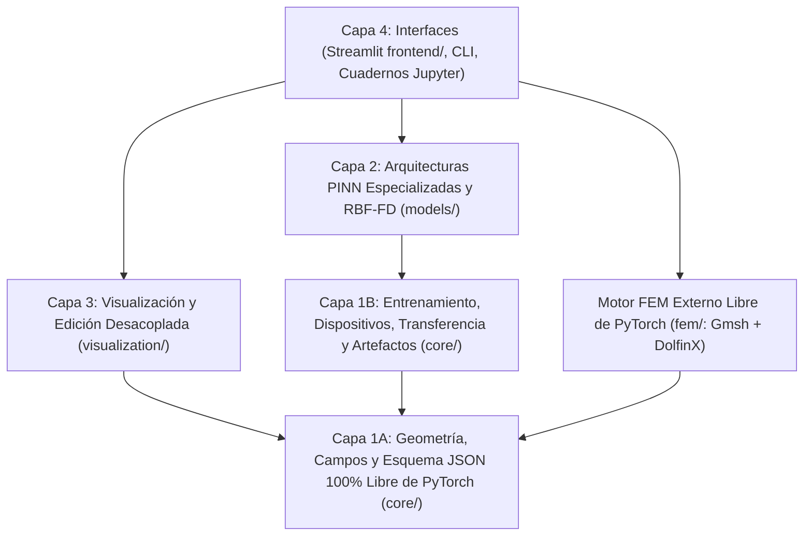

# Arquitectura Modular por Capas de `PINN_V4`

El paquete `pinn_thermal` está estructurado bajo principios de programación orientada a objetos (POO) con separación estricta entre **dominio matemático**, **modelos neuronales**, **evaluación FEM**, **visualización** e **interfaces de usuario**.

## Estructura de Directorios

| Ruta | Responsabilidad | Dependencia de PyTorch |
| :--- | :--- | :--- |
| `core/expressions.py`, `fields.py`, `shapes.py`, `schema.py`, `problem.py`, `manifest.py` | Árbol AST de expresiones, campos heterogéneos (`const`, `expr`, `piecewise`, `table` 1D/2D, `layers`, `patch`), geometrías exactas, validador y catálogo | **Ninguna** en tiempo de importación |
| `core/device.py`, `parallel.py`, `physics.py`, `base_model.py`, `attention.py`, `objective.py` | Backends hardware, `ProcessPoolExecutor` `spawn`, operadores autograd, `BasePINNModel`, `ModelRegistry`, `PhysicsObjective` | Sí (`torch`) |
| `core/artifact.py`, `transfer.py`, `evaluation.py`, `trainer.py`, `ampacity.py` | Formato único `pinn-v4-artifact-1`, `WeightTransfer`, `FunctionalTransfer`, `ChainedPINN`, auditoría energética, `PINNTrainer`, bisección ampacidad | Sí (`torch`) |
| `models/baseline.py`, `cusp.py`, `dcsnn.py`, `fbpinn.py`, `exact.py`, `rbf_init.py`, `deepxde_adapter.py` | Subclases concretas registradas sobre `ModelRegistry` | Sí |
| `fem/ufl_backend.py`, `mesh_resolution.py`, `worker.py`, `runner.py` | Traductor simbólico UFL, trabajador P2 Gmsh/DolfinX y lanzador WSL2/nativo/Docker | `worker.py` **libre de PyTorch** |
| `visualization/grids.py`, `plots.py`, `geometry_editor.py` | Muestreo regular/cortes, Plotly interactivo, Matplotlib estático y constructor fluido JSON | **Independiente** del entrenamiento |
| `frontend/state.py`, `frontend/app.py`, `frontend/views/*.py` | `WorkspaceStore` compartido y vistas multipágina Streamlit | No requiere ejecución para importar `state.py` |
| `cases/benchmarks/`, `cases/thesis_curated/` | 12 casos benchmark verificables + 17 casos curados de cables subterráneos | JSON puro autocontenido |

## Cómo Agregar un Nuevo Modelo PINN

1. Cree una clase en `src/pinn_thermal/models/` heredando de `BasePINNModel`.
2. Defina los bloques de red dentro de `self.networks` (`nn.ModuleList`) e implemente `field(self, region, xy) -> (T, q_opcional)`.
3. Si utiliza subredes con estructura propia, sobrescriba `subnetwork_map(self)` para habilitar automáticamente `WeightTransfer` y proyección `readout`.
4. Decore la clase con `@ModelRegistry.register("NOMBRE", ModelMetadata(...))`. Automáticamente quedará visible en CLI, Jupyter y Streamlit.
